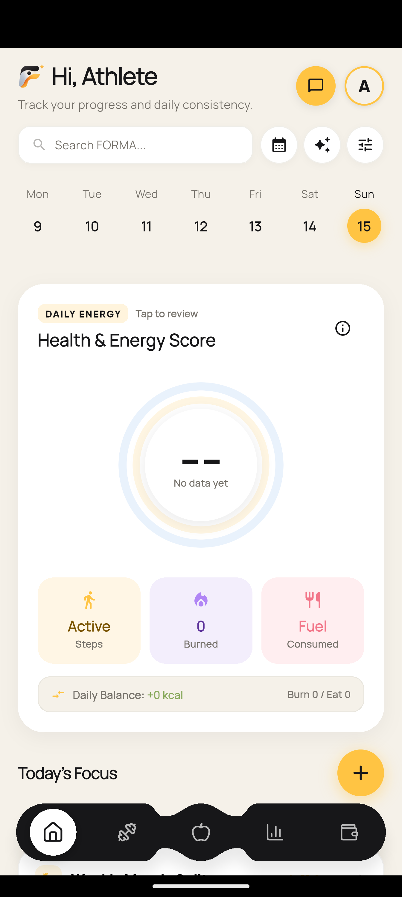
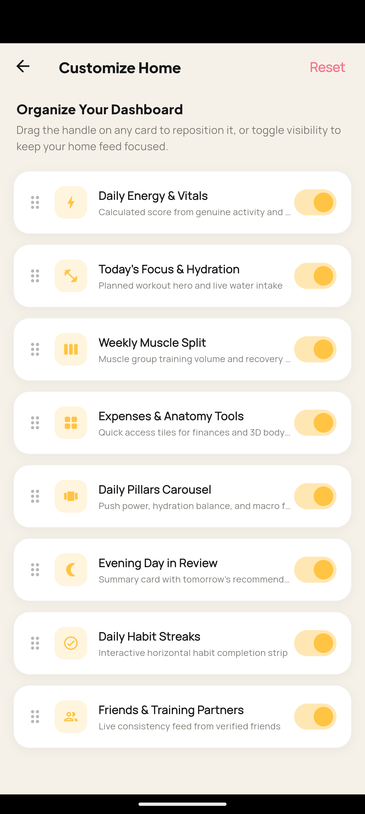
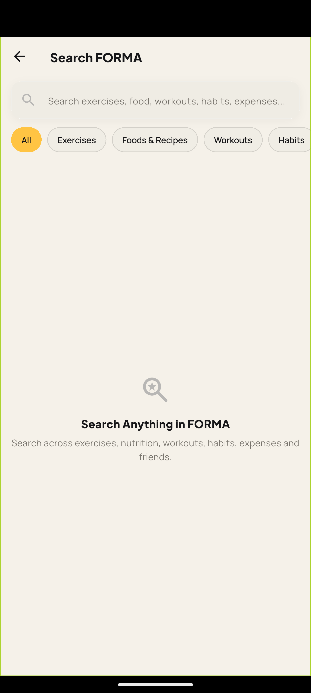
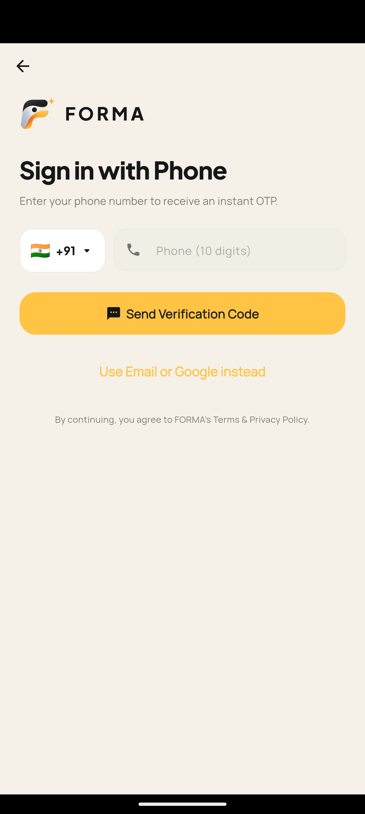
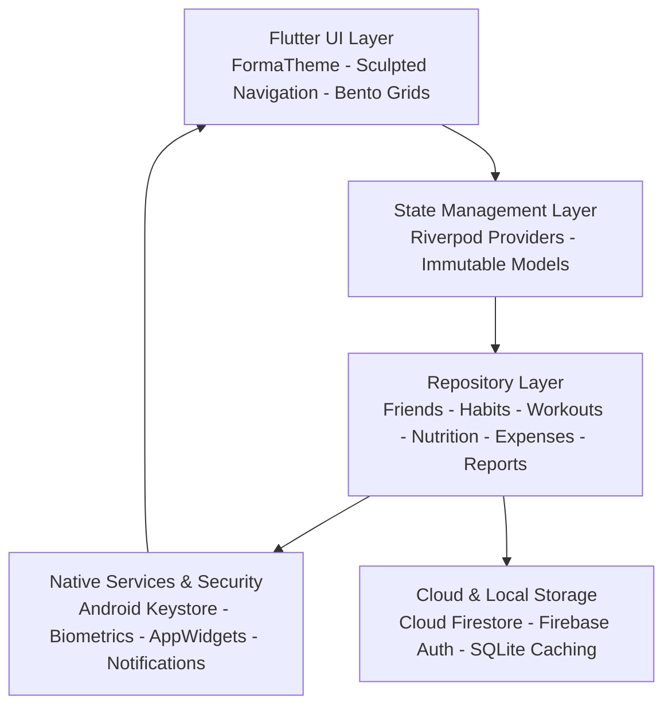

# FORMA — Intelligent Athletic Companion & Habit Architecture

<p align="center">
  
</p>

<p align="center">
  <strong>Train Smarter, Together. Pure Privacy. Zero Compromises.</strong>
</p>

<p align="center">
  
  
  
  
  
  
  
</p>

---

## Executive Overview

**FORMA** is an athletic companion and lifestyle operating system engineered with Flutter and Android 16. Designed around an organic warm-cream and deep-charcoal aesthetic, FORMA unites hyper-detailed strength training, macro nutrition, habit streaks, private budget planning, social accountability, and on-device AI intelligence into a cohesive, privacy-first mobile experience.

### Zero Fake Data Guarantee
FORMA enforces a strict **Zero Fake Data Policy**:
- All energy calculations, muscle distribution graphs, and volume totals are computed deterministically from genuine user sessions.
- Personal finances and spending habits are completely isolated under the authenticated user's private collection with hardware-backed biometric security.
- AI intelligence uses the user's private Google Gemini API key securely encrypted in the Android Keystore.

---

## Visual Showcase & Screenshots

<p align="center">
  
  
  
</p>

<p align="center">
  
  
  
</p>

<p align="center">
  
  
  
</p>

---

## FORMA 2.0 Features & Android 16 Integration

### 1. Native Android Home Screen Widgets
- **Daily Activity Widget**: Real-time step counter, daily workout status, date, and Energy Score with automatic privacy masking.
- **Workout Widget**: Dynamic daily split hero, exercise count, and one-tap "Start Workout" launcher.
- **Budget Widget**: Live spendable daily allowance, period burn rate, and biometric privacy redaction.
- Powered by native Android `AppWidgetProvider` architecture with bidirectional Flutter platform channels (`com.forma.app/home_widgets`).

### 2. Activity Calendar
- High-density monthly and weekly historical calendar view with previous/next month navigation and "Today" jump.
- 5-dot semantic color taxonomy:
  - **Workout**: Athletic Coral (`#F27689`)
  - **Nutrition**: Golden Yellow (`#FFC443`)
  - **Habits**: Soft Icy Blue (`#C5D0DE`)
  - **Cardio & Steps**: Sage Green (`#9CAF88`)
  - **Personal Budget**: Deep Charcoal (`#171719`)
- Interactive day inspection bottom sheet displaying granular exercise sets, macronutrient breakdowns, and expense ledgers.

### 3. Dynamic Android App Icons
- Adaptive launcher icon switching powered by Android `<activity-alias>` declarations:
  - `Default` (Iconic FORMA athlete mark)
  - `Chest`, `Back`, `Legs`, `Arms`, `Rest Day`
- Seamlessly switches to match today's scheduled training split automatically, or manual selection from user profile settings.

### 4. Weekly Intelligence Report ("Your Week in FORMA")
- Comprehensive 7-day retrospective aggregating total volume (tons), cardiovascular steps, macronutrient consistency, and budget adherence.
- 2x2 Bento performance grid accompanied by Gemini AI coaching synthesis and deterministic athletic fallbacks.
- Idempotent Firestore persistence (`users/{uid}/weekly_reports/{weekKey}`) and native Android share sheet integration.

### 5. Customizable Home Dashboard
- Reorderable Bento cards with live preview and drag handles.
- Visibility toggles for all 8 home widgets:
  1. *Daily Energy & Vitals*
  2. *Today's Focus & Hydration*
  3. *Weekly Muscle Split*
  4. *Expenses & Anatomy Tools*
  5. *Daily Pillars Carousel*
  6. *Evening Day in Review*
  7. *Daily Habit Streaks*
  8. *Friends & Training Partners*
- Dual persistence: Instant offline response via `SharedPreferences` + multi-device sync via Firestore.

### 6. Universal Global Search
- Instant full-catalog search with debounced queries across 6 core domains:
  - Exercises (Biomechanics, targeting)
  - Foods & Branded Products
  - Workout History
  - Habits & Routines
  - Private Expenses
  - Friends & Social Groups
- Category filter pills, recent searches persistence, and direct tap-to-navigate action routes.

### 7. Universal Quick-Add Floating Action Button
- Tactile rotating FAB floating comfortably above the sculpted organic bottom navigation bar across all main screens.
- Speed-dial bottom sheet for rapid logging:
  - 🏋️ Log Workout Session
  - 🥗 Log Meal & Food
  - ✅ Track Habit Check-in
  - 💳 Add Personal Expense
  - 👥 Add Shared Expense
  - 💧 Quick Hydration (+250ml)

### 8. Lock Screen Live Workout Status
- Android 16 Live Updates integration utilizing `NotificationCompat.Builder` with stopwatch chronometer base.
- Shows live elapsed duration, active exercise, current set, and pause/resume/finish actions right on the lock screen and Always-On Display.

---

## Architectural Design



### Tech Stack
- **Framework**: Flutter 3.24+ / Dart 3.5+
- **State Management**: `flutter_riverpod`
- **Navigation**: `go_router` with Android 16 Predictive Back Gesture support
- **Backend & Auth**: Firebase Auth (Email, Google Sign-In, Phone OTP), Cloud Firestore, Cloud Storage
- **On-Device AI**: Google Gemini 1.5 / 2.0 Flash via Keystore-secured user keys
- **Hardware Security**: `flutter_secure_storage` (Android Keystore AES-256), `local_auth` (Biometrics)
- **Native Android**: Kotlin platform channels, Material 3 AppWidgets, Activity Aliases, Live Updates

---

## Security & Privacy Architecture

- **Private Expenses**: Stored strictly under `users/{uid}/personal_expenses`. Firestore Security Rules forbid access to any third party.
- **Biometric App Lock**: Optional biometric authentication barrier for financial ledgers and sensitive metrics.
- **Hardware Keystore**: User Gemini API keys are never stored in plain text or synced to remote databases.

---

## Getting Started

### Prerequisites
- Flutter SDK `^3.24.0`
- Android Studio with Android SDK API 34+ (API 36 recommended)
- Java 17

### Installation
1. Clone this repository:
   ```bash
   git clone https://github.com/anandakrishnano-bit/FORMA.git
   cd FORMA
   ```
2. Set up environment configuration:
   ```bash
   cp .env.example .env
   ```
3. Provide your Firebase configuration:
   - Copy `android/app/google-services.json.example` to `android/app/google-services.json` and configure your Firebase project.
4. Install dependencies:
   ```bash
   flutter pub get
   ```
5. Run the application:
   ```bash
   flutter run -d <device_id>
   ```

---

## Verification & Testing

Verify the complete test suite and code quality:

```bash
# Verify static analysis (0 errors, 0 warnings)
flutter analyze --no-fatal-infos

# Run automated test suite (22 passed)
flutter test
```

---

**Made with AI & love.**
