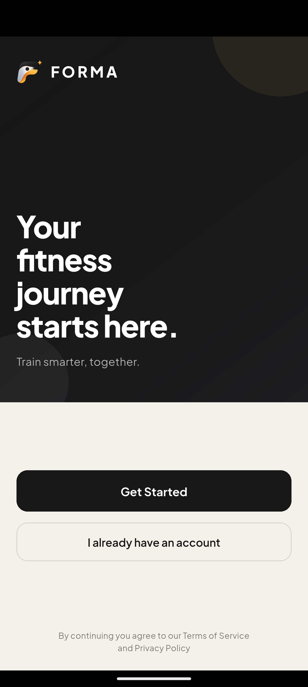
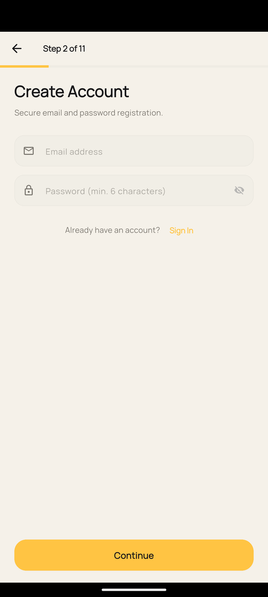
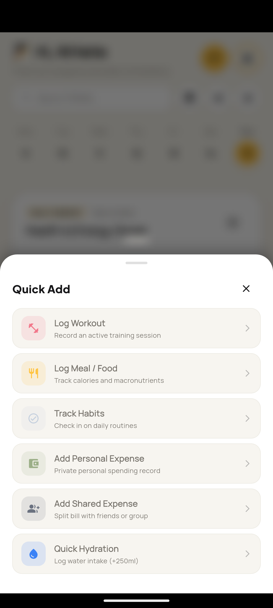
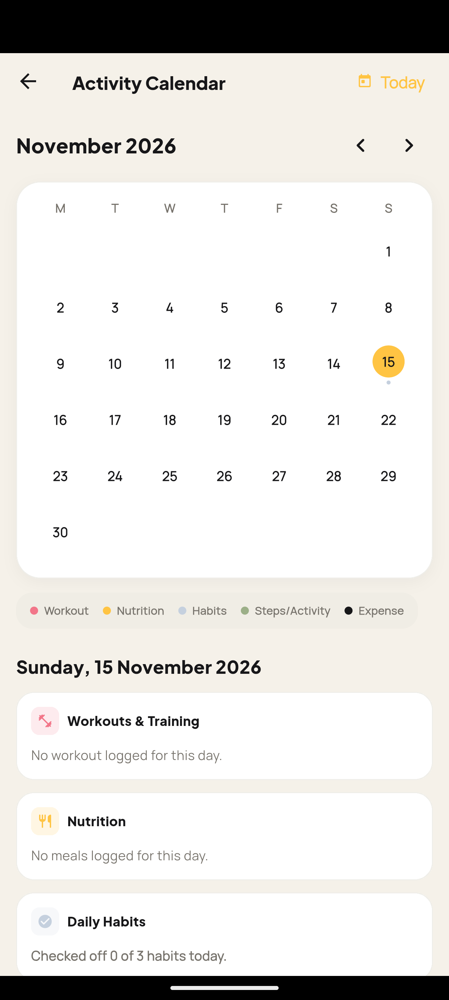
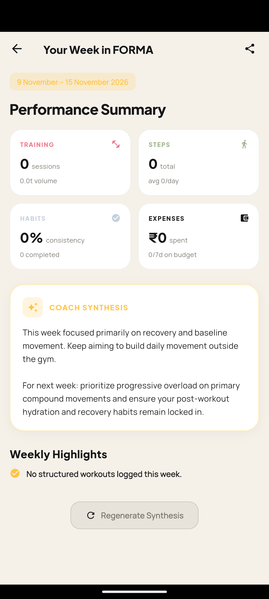
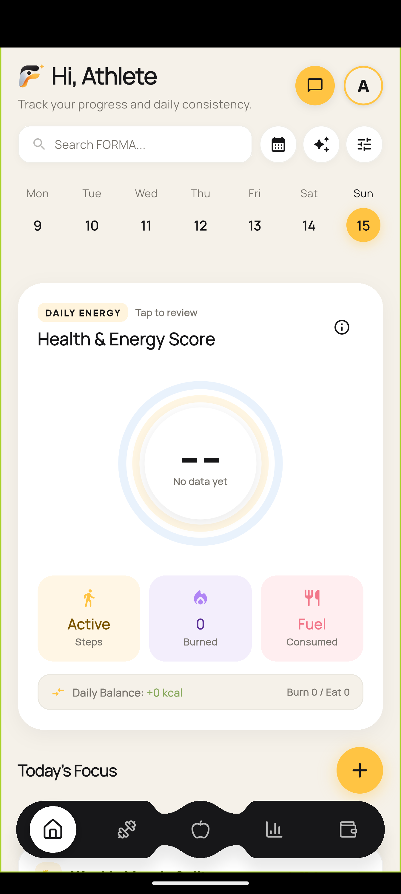
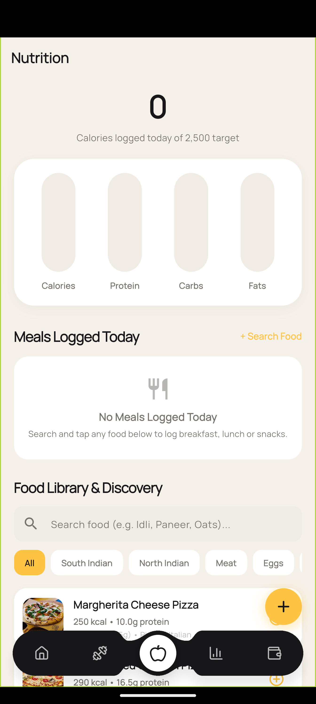
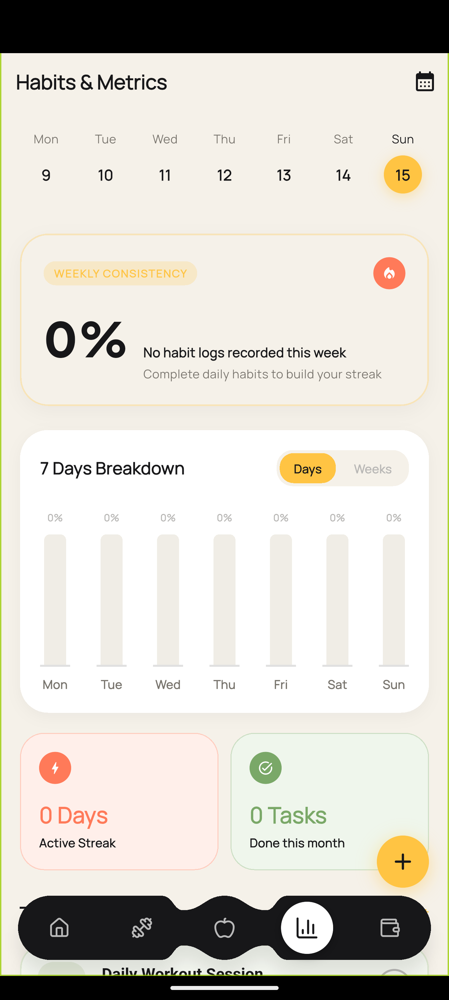
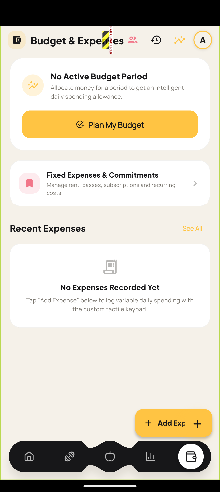
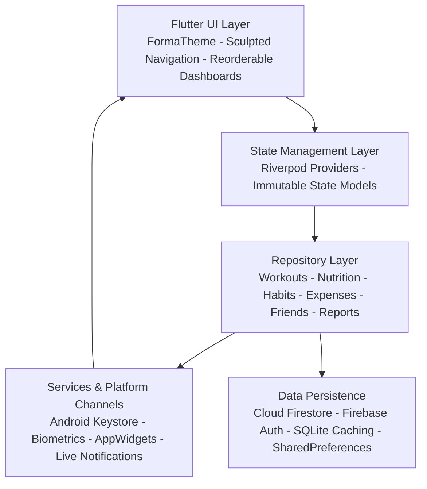

# FORMA

<p align="center">
  
</p>

<p align="center">
  <strong>Your everyday companion for training, nutrition, habits, and mindful living.</strong>
</p>

<p align="center">
  
  
  
  
  
  
  
</p>

---

## 1. Welcome to FORMA

**FORMA** brings together your workouts, meals, daily habits, personal finances, social circles, and smart daily insights into one thoughtfully crafted application.

Instead of jumping between a fitness tracker, a nutrition counter, a habit app, and a budget spreadsheet, FORMA provides a unified space designed around how you actually live. Whether you are logging a heavy deadlift set, checking your daily protein intake, maintaining your reading habit, reviewing your monthly spending, or sharing progress with training partners, FORMA keeps your day organized, clear, and intentional.

Built with Flutter and deeply integrated with modern Android, FORMA pairs a calm, organic aesthetic—warm cream tones, deep charcoal contrasts, and soft athletic accents—with a strict commitment to your privacy and authentic data.

---

## 2. Why FORMA?

Modern lifestyle apps are often fragmented, noisy, or cluttered with artificial metrics. FORMA takes a different approach:

- **Everything in one place**: Your training volume, macronutrients, routines, and budget live together so you see the complete picture of your day.
- **Privacy by default**: Your personal expenses, notes, and habits belong to you alone. Sensitive data is protected with on-device hardware encryption and biometric lock.
- **Honest metrics**: We never fabricate streaks, show synthetic energy scores, or invent activity. Every chart, summary, and recommendation reflects real logs you created.
- **Fast and responsive**: Designed for everyday use with one-tap quick-add actions, offline caching, and responsive layouts that adapt to any screen size.
- **Helpful, not overwhelming**: Smart summaries distill your week into actionable highlights without burying you in complex dashboards.

---

## 3. Visual Overview

<p align="center">
  
  
  
</p>

<p align="center">
  
  
  
</p>

<p align="center">
  
  
  
</p>

<p align="center">
  
  
  
</p>

---

## 4. Everything You Can Do with FORMA

| Area | What You Can Do |
| :--- | :--- |
| **Home & Daily Overview** | View your personalized daily dashboard, track your Energy Score, review daily activity, and access quick actions. |
| **Workouts & Fitness** | Plan and record exercises, log sets and weights, view personal records (PRs), and track muscle recovery splits. |
| **Nutrition & Meals** | Search whole and branded foods, log meals with custom portion sizes, and monitor your calorie and macronutrient balance. |
| **Habits & Routines** | Build positive daily routines, check in with one tap, build streaks, and sync daily step counts via Health Connect. |
| **Expenses & Budgeting** | Manage your private monthly budget, track everyday expenses, and split shared group costs with friends. |
| **Friends & Accountability**| Connect with friends, celebrate streaks, join shared groups, and participate in fitness challenges. |
| **Intelligent Insights** | Get personalized conversational guidance, evening day reviews, and comprehensive weekly reports. |
| **Android Integration** | Enjoy home screen widgets, lock screen live workout timers, dynamic app icons, and smooth predictive back gestures. |

---

## 5. Home and Daily Overview

Your Home screen is your daily headquarters, adapting to what matters most to you:

- **Personalized Home Layout**: Choose which pillars appear on your dashboard—Workouts, Nutrition, Habits, or Expenses—and reorder them to match your personal flow.
- **Daily Activity & Steps**: Connect with Health Connect to automatically see daily steps, walking distance, and active calories.
- **Energy & Progress Tracking**: See a transparent, calculated readiness score that reflects your genuine rest, workout volume, and nutrition consistency.
- **Evening Daily Review**: Receive a gentle end-of-day summary that brings together what you accomplished across all pillars.
- **Customizable Dashboard**: Long-press or visit Customize Home to reorder cards, hide sections you don't need, and preview your layout in real time.
- **Universal Quick-Add**: A tactile floating button available on every main screen lets you log a workout, meal, habit, expense, or glass of water in seconds.
- **Activity Calendar**: View your monthly consistency at a glance with a clean 5-color dot taxonomy (Workouts, Nutrition, Habits, Steps, Budget), with tap-to-inspect daily breakdowns.
- **Global Search**: Instantly find past workouts, exercises, meals, habits, expenses, or friends from a unified search bar with helpful category filters.

---

## 6. Workouts and Fitness

FORMA offers comprehensive strength and conditioning tracking built for lifters and athletes:

- **Rich Exercise Library**: Explore hundreds of movements categorized by target muscle group (Chest, Back, Legs, Shoulders, Arms, Core) and equipment type (Barbell, Dumbbell, Cable, Machine, Bodyweight).
- **Flexible Logging**: Record warm-up sets, working sets, drop sets, and failure sets with exact weights and reps.
- **Personal Records (PRs)**: Automatically tracks your all-time heaviest lifts and estimated 1-rep maxes with celebratory badges.
- **Weekly Muscle Split**: Visual indicators highlight which muscle groups you have trained this week and which still need attention.
- **Active Workout Session**: Follow your active workout with a clean interface, set checkboxes, and built-in rest timers with gentle haptic alerts.
- **Lock Screen Live Status**: Keep track of your workout duration, current exercise, and active set directly from your Android lock screen without unlocking your phone.

---

## 7. Nutrition and Meals

Fuel your body with straightforward, honest food tracking:

- **Extensive Food Database**: Search thousands of whole foods, pantry staples, and branded products with verified nutritional values.
- **Portion Flexibility**: Log food using standard serving sizes (grams, ounces, bowls, cups, pieces) or enter custom portion weights.
- **Macronutrient Breakdown**: Keep an eye on daily protein, carbohydrates, fats, and calories with clean circular progress rings.
- **Meal Organization**: Group your intake by Breakfast, Lunch, Dinner, and Snacks to understand your daily eating cadence.
- **Meal History**: Look back at previous days to see what meals gave you the best energy and workout performance.

---

## 8. Habits and Activity

Small daily routines compound into long-term results:

- **Custom Habits**: Create habits for anything that matters to you—hydration, stretching, morning walks, reading, or sleep routines.
- **One-Tap Check-Ins**: Mark habits complete in a single tap directly from your Home screen or the dedicated Habits tab.
- **Streak Tracking**: Maintain your consistency streaks with visual progress indicators that motivate you without pressure.
- **Health Connect Integration**: Sync your daily steps and active energy seamlessly in the background.
- **Historical Trends**: Inspect weekly and monthly completion rates to spot patterns in your consistency over time.

---

## 9. Expenses and Budgeting

Taking control of your finances is an essential part of a balanced lifestyle. FORMA provides a clear separation between your **private personal budget** and **shared group expenses**:

### Private Personal Budget
- **Private by Default**: Your personal expenses are stored securely under your private account. No other user can view your personal spending.
- **Monthly Budget Planning**: Set a target budget for the month and monitor your burn rate over time.
- **Daily Spending Allowance**: Automatically calculates how much you can comfortably spend each day based on remaining funds and days left in the month.
- **Category Organization**: Tag expenses by Groceries, Dining, Fitness, Bills, Transport, Shopping, and Entertainment.
- **Recurring Commitments**: Track fixed monthly commitments (gym memberships, rent, subscriptions) to see your true disposable income.
- **Biometric Protection**: Lock your financial records behind fingerprint or face recognition for total peace of mind.

### Shared Expenses & Group Splitting
- **Split Group Costs**: Easily split restaurant bills, gym passes, trip expenses, or shared groceries with training partners.
- **Exact-Share Calculations**: Distribute expenses equally or by custom amounts down to the exact cent.
- **Settlement Tracking**: Keep a transparent tally of who paid, who owes what, and record settlements when accounts are cleared.

---

## 10. Friends, Groups and Challenges

Stay motivated together without the distractions of a social media feed:

- **Accountability Partners**: Add training partners and friends via username, email, or invite link.
- **Friend Profiles**: View your friends' public training streaks, favorite exercises, and workout milestones.
- **Activity Sharing**: Choose to share workout completions and habit milestones with your accountability circle.
- **Social Groups**: Form groups for your local gym crew, running club, or workplace challenge.
- **Friendly Challenges**: Join monthly step challenges, consistency competitions, and volume goals.
- **Distraction-Free**: FORMA is purposefully designed for mutual motivation, shared accountability, and challenge tracking—not instant messaging or endless chat feeds.

---

## 11. AI and Intelligent Insights

FORMA includes an intelligent assistant that helps you reflect and grow:

- **Personal AI Assistant**: Ask questions about workout form, recovery tips, meal ideas, or how to structure your training split.
- **Evening Daily Review**: Receive a helpful narrative summary of your daily achievements, highlighting what went well and where you can focus tomorrow.
- **Weekly Intelligence Reports ("Your Week in FORMA")**: Every week, FORMA compiles your total training tonnage, step volume, nutrition consistency, and budget adherence into a clear retrospective report.
- **Mindful Spending Summaries**: Get objective, helpful highlights on your spending trends to help you hit your savings goals.
- **Clear & Jargon-Free**: Insights are delivered in natural, encouraging everyday language, avoiding technical jargon or confusing algorithms.

---

## 12. Native Android Integration

FORMA is engineered to feel like an authentic, first-class citizen on Android:

- **Home Screen Widgets**:
  - *Daily Activity Widget*: Real-time step counts, workout status, and current date right on your home screen.
  - *Workout Widget*: Today's scheduled muscle split, exercise count, and a one-tap shortcut to begin your session.
  - *Budget Widget*: Today's spendable allowance with privacy masking support.
- **Lock Screen Live Status**: Follow your workout timer and active exercise without unlocking your device, powered by Android Live Updates.
- **Dynamic App Icons**: Choose from custom launcher icons that reflect your current workout split (Chest, Back, Legs, Arms, Rest Day) or your personal aesthetic.
- **Predictive Back Gestures**: Fully supports Android 14+ predictive back gestures for smooth transitions across all screens and sheets.
- **Native Notifications**: Timely rest interval chimes, workout reminders, and evening reviews scheduled natively on your device.

---

## 13. Privacy and Security Architecture

Your health, habits, and financial records deserve the highest standard of security:

- **Private by Default**: Your personal expenses, notes, and habits are kept strictly confidential and are never shared with other users.
- **Hardware-Backed Encryption**: Sensitive authentication credentials and connection keys are encrypted using the Android Keystore with AES-256-GCM.
- **Biometric App Lock**: Secure your financial ledger and sensitive health logs with Android biometric authentication (fingerprint or face unlock).
- **Zero Fake Data Policy**: FORMA never populates your dashboard with fabricated numbers, placeholder stats, or synthetic streaks. Every metric represents actual logs created by you.

---

## 14. Technology & Architecture

*(Developer Documentation)*

FORMA is built using modern Flutter and native Android architecture patterns, emphasizing clean separation of concerns, testability, and deterministic performance.

### Architectural Diagram



### Core Technologies
- **UI Framework**: Flutter 3.24+ with Dart 3.5+
- **State Management**: `flutter_riverpod` with immutable models and clean provider hierarchies
- **Routing & Navigation**: `go_router` with nested shell routes and Android predictive back support
- **Backend & Synchronization**: Firebase Authentication (Google Sign-In, Email/Password, Phone OTP), Cloud Firestore, Cloud Storage
- **Offline Caching**: `sqflite` for local offline storage and instant startup reads
- **Hardware Security**: `flutter_secure_storage` backed by the Android Keystore, `local_auth` for biometric verification
- **Native Android Modules**: Kotlin platform channels for AppWidgets (`AppWidgetProvider`), Live Updates notifications (`NotificationCompat.Builder`), and dynamic launcher icon switching (`<activity-alias>`)
- **Health Data**: Health Connect API via platform channels

---

## 15. Getting Started

### Prerequisites
Before you begin, ensure you have the following installed on your development machine:
- **Flutter SDK**: `^3.24.0` ([Installation Guide](https://docs.flutter.dev/get-started/install))
- **Dart SDK**: `^3.5.0` (included with Flutter)
- **Android Studio**: Ladybug or newer with Android SDK API 34+ (API 36 recommended)
- **Java Development Kit**: JDK 17
- A physical Android device or Android Virtual Device (AVD) running Android 10+ (Android 14+ recommended for predictive back)

### Installation Steps

1. **Clone the repository**:
   ```bash
   git clone https://github.com/anandakrishnano-bit/FORMA.git
   cd FORMA
   ```

2. **Set up environment variables**:
   Create a `.env` file in the project root:
   ```bash
   cp .env.example .env
   ```

3. **Configure Firebase**:
   Place your project's `google-services.json` inside the `android/app/` directory:
   ```bash
   # Copy your configuration file
   cp path/to/your/google-services.json android/app/google-services.json
   ```

4. **Install Flutter dependencies**:
   ```bash
   flutter pub get
   ```

5. **Run the application**:
   ```bash
   # List available connected devices
   flutter devices

   # Run on your connected device
   flutter run -d <device-id>
   ```

---

## 16. Verification and Testing

FORMA includes a comprehensive automated test suite covering unit logic, financial arithmetic, and authentication routing:

```bash
# Verify static analysis (0 errors, 0 warnings)
flutter analyze --no-fatal-infos

# Run the complete test suite (26 passing tests)
flutter test

# Verify code formatting
dart format --set-exit-if-changed lib test
```

### Key Test Suites
- `test/budget_and_social_test.dart`: Budget arithmetic, daily allowance minor-unit math, food search categorization, and social group lifecycle.
- `test/expense_and_portion_test.dart`: Split-bill exact-cent allocations, portion size nutritional conversions, and muscle split calculations.
- `test/forma_2_features_test.dart`: Home screen reordering, configuration serialization, and weekly intelligence report aggregation.
- `test/onboarding_auth_flow_test.dart`: Returning-user login guards, fresh registration flag persistence, and honest zero-state summaries.
- `test/security_and_auth_test.dart`: Phone number sanitization, country code catalogues, biometric settings persistence, and auth email action routing.

---

## 17. Project Status and Contributing

FORMA is under active development. We welcome contributions, bug reports, and suggestions that align with our core design principles and privacy philosophy.

### Guidelines for Contributors
1. **Preserve Privacy & Zero Fake Data**: Never commit hardcoded user data, synthetic stats, or plain-text credentials.
2. **Follow Design System Standards**: Use the established `FormaColors`, `FormaTypography`, and responsive spacing conventions.
3. **Write Tests**: Ensure any new arithmetic, data transformations, or routing logic are accompanied by automated tests in `test/`.
4. **Code Quality**: Verify that `flutter analyze` and `flutter test` pass with zero issues before submitting pull requests.

---

**Made with AI & love.**
